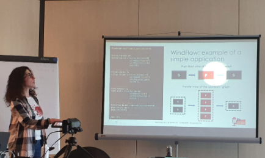

<h2 align="center"> Hey, I'm Alessandra </h2>

Software engineer and researcher with a PhD in network programming. I work on C/C++ on Linux, high-performance networking, eBPF/XDP, and embedded firmware.

  

---

### Some of my works and contributions 🚀

* [Nethuns](https://github.com/larthia/nethuns) open-source I/O library. Contributions to the AF_XDP and XDP/eBPF backend, with code review, debugging, test programs, and the original README. Co-authored the [Nethuns paper](https://doi.org/10.1145/3544912.3544917) (ACM CCR, Best of CCR 2022).</li>

* [ZeroNoise](https://github.com/zeronoise-zn): firmware distribution and update guides for rally helmet communication systems.</li>

* Thesis benchmark: four real-world general-purpose data stream processing applications implemented with [Apache Storm](https://github.com/alefais/storm-applications), [Apache Flink](https://github.com/alefais/flink-applications) and [WindFlow](https://github.com/alefais/windflow-applications), part of the MSc thesis (2019) work and then used in the performance evaluation of the [WindFlow paper](https://doi.org/10.1109/TPDS.2021.3073970) (IEEE TPDS, 2021).

* Telemetry benchmark: a heavy hitter detection network traffic query implemented with four different Stream Processing Systems (SPSs), Apache Storm, Apache Flink, Apache SparkStreaming and WindFlow. This [benchmark](https://github.com/alefais/packet-streaming-bench-sigcomm22poster) and the resulting poster “Mind the Cost of Telemetry Data Analysis” (ACM SIGCOMM 2022) aim to shed some light on the best streaming engine for network traffic analysis.

* Cloud-related demos: [REST API](https://github.com/alefais/epicode-rest-api-demo), [CI/CD](https://github.com/alefais/epicode-cicd-demo) pipeline, [application deployment](https://github.com/alefais/epicode-app-deploy-demo) examples for Docker and Kubernetes, and a [Terraform](https://github.com/alefais/epicode-terraform-demo) project designed for a BSc degree university course.

* Virtualization Lab: [code examples](https://github.com/alefais/virtualization-lab-unipi) designed for a MSc degree university networking course, together with the teaching material ([teaching material](https://github.com/alefais/personal-site/blob/master/static/teaching/wirelessnetworks2022/)).

### Talks and presentations 🌍

  

#### Conferences

* [2020 IEEE 25th International Workshop on Computer Aided Modeling and Design of Communication Links and Networks (CAMAD)](https://camad2020.ieee-camad.org/program/index.html), **Data Stream Processing in Software Defined Networks: Perspectives and Challenges**: [paper](https://doi.org/10.1109/camad50429.2020.9209303), [talk slides](https://github.com/alefais/personal-site/tree/master/static/presentations/conferences/2020-IEEE-CAMAD.pdf).
* [2020 IEEE Conference on Network Function Virtualization and Software Defined Networks (NFV-SDN)](https://nfvsdn2020.ieee-nfvsdn.org/index.html), **On the Design of Fast and Scalable Network Applications Through Data Stream Processing**: [paper](https://doi.org/10.1109/nfv-sdn50289.2020.9289855), [talk slides](https://github.com/alefais/personal-site/blob/master/static/presentations/conferences/2020-IEEE-NFV-SDN.pdf), [Intel Award](https://github.com/alefais/personal-site/blob/master/static/cert/NFVSDN2020_Certificate%20SPG_Fais.pdf).
* [2022 ACM SIGCOMM Posters, Demos, and Student Research Competition](https://conferences.sigcomm.org/sigcomm/2022/cf-posters.html), **Mind the Cost of Telemetry Data Analysis**: [paper](https://doi.org/10.1145/3546037.3546052), [poster](https://github.com/alefais/packet-streaming-bench-sigcomm22poster/blob/master/Fais-sigcomm22posters-poster63-A0.pdf), [cert](https://github.com/alefais/personal-site/blob/master/static/cert/Fais_SIGCOMM22_SRC_Cert.pdf).

#### Misc

* [2020 NetResults Srl NeRdTalks (company event)](https://www.kalliope.com/year-talk/2020/page/2/) **Implementing Data Stream Processing applications with the WindFlow library**: [talk slides](https://github.com/alefais/personal-site/blob/master/static/presentations/other-talks/nerdtalks-vol6-windflow.pdf).
* 2021, internal talk in the department, **XDP: the eXpress Data Path**: [talk slides](https://github.com/alefais/personal-site/blob/master/static/presentations/other-talks/XDP-the-eXpress-Data-Path.pdf).
* [2022 NetResults Srl NeRdTalks (company event)](https://www.kalliope.com/year-talk/2022/page/2/) **Towards Scalable and Expressive Stream Packet Processing**: [talk slides](https://github.com/alefais/personal-site/blob/master/static/presentations/other-talks/nerdtalks-s03e03-windflow-packet-analysis.pdf).

<!--and [others](https://alefais.github.io/talks/)...-->

### Publications 📚

 &nbsp; 

### Connect with me 🔗

<!-- &nbsp;  &nbsp; -->

<!--
Made with 🖤 @alefais
-->